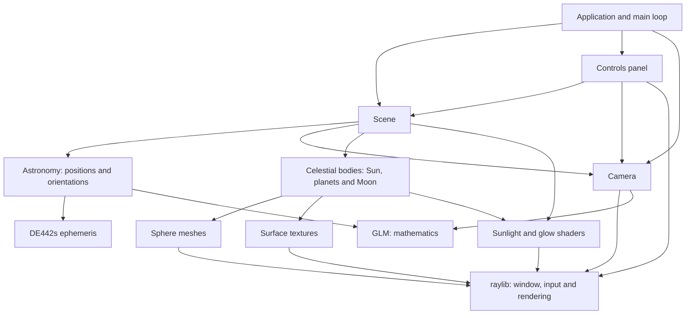

# Solar System

A solar system viewer written in C++.

Explore the Sun, all eight planets, Pluto and Earth's Moon. Saturn's main rings are
shown as well.


## Setup

You need CMake 3.24 or newer, a C++23 compiler, libcurl 7.85 or newer, Git and an internet connection
for the first build.

```sh
cmake -S . -B build -DCMAKE_BUILD_TYPE=Release
cmake --build build
./build/solar_system
```

## Downloads

CMake downloads [GLM 1.0.2](https://github.com/g-truc/glm) and
[raylib 6.2](https://github.com/raysan5/raylib) when configuring the project.
During the build, it downloads any missing textures into `assets/textures/`:

- [Earth day map](https://www.solarsystemscope.com/textures/download/2k_earth_daymap.jpg)
  and [Moon map](https://www.solarsystemscope.com/textures/download/2k_moon.jpg),
  along with the other planets and Saturn's rings, from [Solar System Scope / INOVE](https://www.solarsystemscope.com/textures/)
  under [CC BY 4.0](https://creativecommons.org/licenses/by/4.0/).
- [Earth at night](https://assets.science.nasa.gov/content/dam/science/esd/eo/images/imagerecords/144000/144898/BlackMarble_2016_01deg.jpg),
  NASA's Black Marble 2016 composite.

The build also downloads the [DE442s ephemeris](https://naif.jpl.nasa.gov/pub/naif/generic_kernels/spk/planets/de442s.bsp)
from NASA JPL into `assets/de442s.bsp`. It verifies the downloaded files and
reuses them on later builds. See [assets/README.md](assets/README.md) for details.

The background stars come from the [Hipparcos catalogue](https://heasarc.gsfc.nasa.gov/W3Browse/star-catalog/hipparcos.html)
(ESA, 1997), downloaded from a [catalogue mirror](https://github.com/Lokilife/hipparcos-data)
and checked against a fixed checksum. The file is cached under `assets/stars/`,
so the star field works offline after the first build. Stars are shown in their
catalogue directions (epoch 1991.25), without proper motion or parallax.

When Earth is the nearest body, the Clouds button fetches the latest cloud map
from [Live Cloud Maps](https://clouds.matteason.co.uk/images/2048x1024/clouds.jpg).
The download runs in the background; use Refresh to request an update or retry a failure. A
previously loaded map remains available for the current session.
Contains modified EUMETSAT data.

Pluto uses the same AI-assisted illustration as the Odin viewer, derived from
NASA/JHUAPL/SwRI's [New Horizons global colour map](https://science.nasa.gov/resource/pluto-global-color-map/).
It fills areas without image coverage and alters some observed detail; it is not
a scientific map of Pluto's unobserved terrain.

Use the mouse wheel or arrow keys to scroll the destination list when it is too
tall for the window. Use Hide and Controls to collapse and reopen the panel.
The outer planets use DE442s system barycentres as an
approximation to the planets' centres. Their axial tilts and rotation rates are
based on IAU models; their starting surface longitudes are illustrative.

## Architecture

The application sets up the scene and runs the update and draw loop. The scene
uses ephemeris data and body orientations to update the Sun, planets and Moon;
the controls panel and camera handle navigation.


