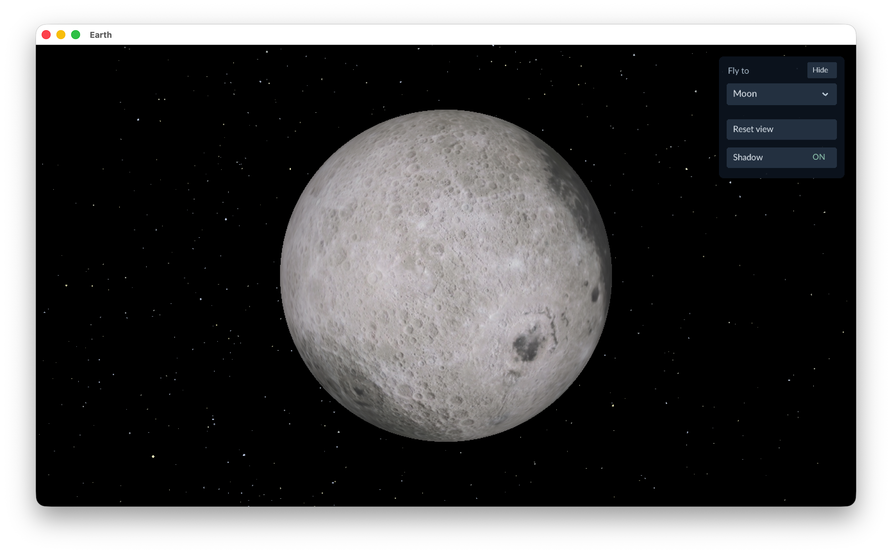
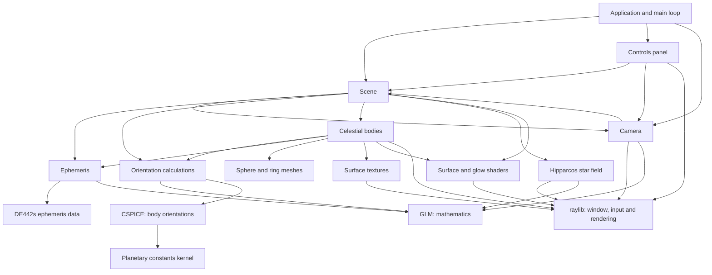

# Solar System

A solar system viewer written in C++.





## Setup

You need CMake 3.24 or newer, a C++23 compiler, libcurl 7.85 or newer, Git and
an internet connection for the first build.

```sh
cmake -S . -B build -DCMAKE_BUILD_TYPE=Release
cmake --build build
./build/solar_system
```

## Third-party libraries

- [raylib](https://www.raylib.com/) provides the window, input, rendering,
  shaders, textures and font handling. CMake fetches version 6.2. It uses the
  [zlib licence](https://github.com/raysan5/raylib/blob/6.2/LICENSE).
- [GLM](https://github.com/g-truc/glm) provides vector and matrix mathematics
  for positions, camera movement and orientations. CMake fetches version 1.0.2;
  it is available under the [MIT licence](https://github.com/g-truc/glm/blob/1.0.2/copying.txt).
- [CSPICE](https://naif.jpl.nasa.gov/naif/toolkit.html), the C version of
  NASA/JPL's SPICE toolkit, reads the planetary constants kernel and calculates
  the Moon's and planets' orientations. CMake fetches a pinned
  [source mirror](https://github.com/tudat-team/cspice-cmake) and builds it
  locally. See [NAIF's rules for using SPICE](https://naif.jpl.nasa.gov/naif/rules.html).
- [ERFA](https://github.com/liberfa/erfa) is the source of the adapted Earth
  rotation and precession formulas in `src/astronomy/planet_orientation.cpp`.
  The project does not link the ERFA library. Its three-clause BSD licence and
  notice are included in [erfa.txt](src/astronomy/erfa.txt).
- [libcurl](https://curl.se/libcurl/) downloads live cloud maps over HTTPS. It
  must be installed separately and is used under the [curl licence](https://curl.se/docs/copyright.html).
  The `curl` command also downloads build assets.

## Data and downloads

CMake downloads [GLM 1.0.2](https://github.com/g-truc/glm), [CSPICE](https://naif.jpl.nasa.gov/naif/toolkit.html), and
[raylib 6.2](https://github.com/raysan5/raylib) during configuration. The first
build downloads any missing data into the build directory with curl:

- [Planetary constants kernel](https://naif.jpl.nasa.gov/pub/naif/generic_kernels/pck/pck00011.tpc) for body orientations.
- [DE442s ephemeris](https://naif.jpl.nasa.gov/pub/naif/generic_kernels/spk/planets/de442s.bsp)
  from NASA JPL, for body positions. See [Ephemeris](#ephemeris).
- [Hipparcos star catalogue](https://heasarc.gsfc.nasa.gov/W3Browse/star-catalog/hipparcos.html)
  (ESA, 1997), from a [catalogue mirror](https://github.com/Lokilife/hipparcos-data).
- Planet, Moon and Saturn ring textures from [Solar System Scope / INOVE](https://www.solarsystemscope.com/textures/),
  licensed under [CC BY 4.0](https://creativecommons.org/licenses/by/4.0/).
- NASA's [Black Marble 2016](https://assets.science.nasa.gov/content/dam/science/esd/eo/images/imagerecords/144000/144898/BlackMarble_2016_01deg.jpg)
  composite for Earth's night lights.

The live cloud map comes from [Live Cloud Maps](https://clouds.matteason.co.uk/images/2048x1024/clouds.jpg).
Contains modified EUMETSAT data.

Pluto uses a bundled AI-assisted illustration derived from the NASA/JHUAPL/SwRI
[New Horizons global colour map](https://science.nasa.gov/resource/pluto-global-color-map/).
It fills areas without image coverage and alters some observed detail.

## Ephemeris

The application uses NASA JPL's DE442s planetary ephemeris (`de442s.bsp`) to
find the positions of solar system bodies over time.

Source: https://ssd.jpl.nasa.gov/planets/eph_export.html

## Licence

The original project code and material may be used and shared for non-commercial
purposes. Commercial use requires permission. See [LICENSE](LICENSE). Third-party
dependencies and assets have their own licences and notices.

## Architecture

All bodies, including the Sun, are created with `CelestialBody::Builder`. It configures
the surface, shared `SurfaceShader` and orientation, with optional night lights, clouds and
rings and animated glow. No body-specific subclasses are needed; the Sun uses
an unlit solid surface with an optional shared `SunGlow` effect.

`Clouds` accepts a source URL and expected JPEG dimensions rather than assuming
an Earth-specific provider. Downloads run asynchronously through the HTTPS
helper in `src/http/`; image validation, decoding and GPU uploads remain on the
render thread. Each cloud image is limited to 8 MiB and 16 megapixels.


