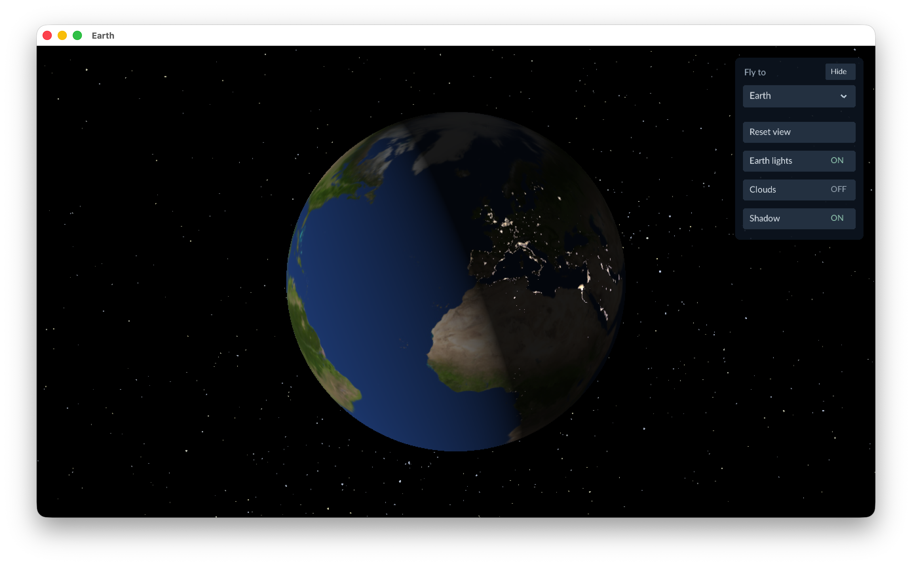
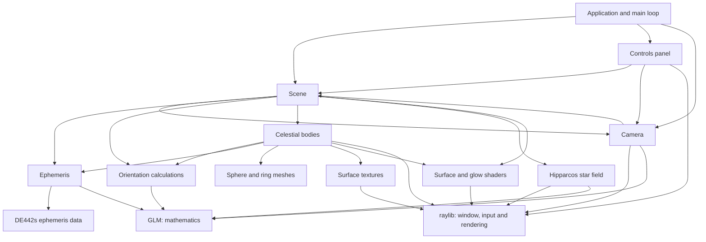

# Solar System

A solar system viewer written in C++.




## Setup

You need CMake 3.24 or newer, a C++23 compiler, libcurl 7.85 or newer, Git and
an internet connection for the first build.

```sh
cmake -S . -B build -DCMAKE_BUILD_TYPE=Release
cmake --build build
./build/solar_system
```

## Data and downloads

CMake downloads [GLM 1.0.2](https://github.com/g-truc/glm) and
[raylib 6.2](https://github.com/raysan5/raylib) during configuration. The first
build downloads any missing data into the build directory with curl:

- [DE442s ephemeris](https://naif.jpl.nasa.gov/pub/naif/generic_kernels/spk/planets/de442s.bsp)
  from NASA JPL, for body positions. See [Ephemeris](#ephemeris).
- [Hipparcos star catalogue](https://heasarc.gsfc.nasa.gov/W3Browse/star-catalog/hipparcos.html)
  (ESA, 1997), from a [catalogue mirror](https://github.com/Lokilife/hipparcos-data).
- Planet, Moon and Saturn ring textures from [Solar System Scope / INOVE](https://www.solarsystemscope.com/textures/),
  licensed under [CC BY 4.0](https://creativecommons.org/licenses/by/4.0/).
- NASA's [Black Marble 2016](https://assets.science.nasa.gov/content/dam/science/esd/eo/images/imagerecords/144000/144898/BlackMarble_2016_01deg.jpg)
  composite for Earth's night lights.

The live cloud map comes from [Live Cloud Maps](https://clouds.matteason.co.uk/images/2048x1024/clouds.jpg).
Contains modified EUMETSAT data.

Pluto uses a bundled AI-assisted illustration derived from the NASA/JHUAPL/SwRI
[New Horizons global colour map](https://science.nasa.gov/resource/pluto-global-color-map/).
It fills areas without image coverage and alters some observed detail.

## Ephemeris

The application uses NASA JPL's DE442s planetary ephemeris (`de442s.bsp`) to
find the positions of solar system bodies over time.

Source: https://ssd.jpl.nasa.gov/planets/eph_export.html

## Accuracy

The outer planets use DE442s system barycentres as approximations to their
centres. Their axial tilts and rotation rates use IAU models, but their starting
surface longitudes are illustrative. Stars use their Hipparcos catalogue
directions at epoch 1991.25, without proper motion or parallax.

## Licence

The original project code and material may be used and shared for non-commercial
purposes. Commercial use requires permission. See [LICENSE](LICENSE). Third-party
dependencies and assets have their own licences and notices.

## Architecture

All bodies, including the Sun, are created with `CelestialBody::Builder`. It configures
the surface, shared `SurfaceShader` and orientation, with optional night lights, clouds and
rings and animated glow. No body-specific subclasses are needed; the Sun uses
an unlit solid surface with an optional shared `SunGlow` effect.

`Clouds` accepts a source URL and expected JPEG dimensions rather than assuming
an Earth-specific provider. Downloads run asynchronously through the HTTPS
helper in `src/http/`; image validation, decoding and GPU uploads remain on the
render thread. Each cloud image is limited to 8 MiB and 16 megapixels.


