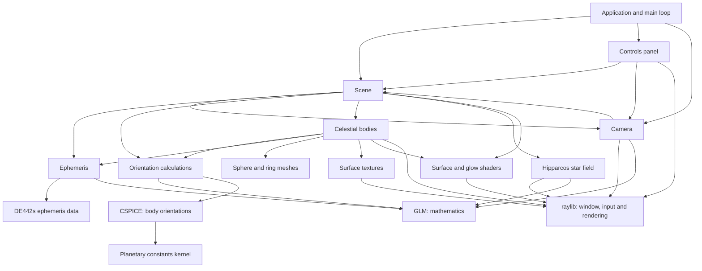

# Solar System

A solar system viewer written in C++. Explore 21 moons from Earth to Pluto.
[Moon list, orbital data and texture credits](docs/moons.md).


## Setup

* CMake 3.24 or newer
* C++23 compiler
* libcurl 7.85

```sh
cmake -S . -B build -DCMAKE_BUILD_TYPE=Release
cmake --build build
./build/solar_system
```

The first build caches planetary textures in `assets/textures/`, moon maps and models in
`assets/moons/`, JPL kernels in `assets/kernels/`, and the star catalogue in `assets/stars/`.
These downloads are ignored by Git and shared by all build directories in the checkout.

## Third-party libraries and data

- [raylib](https://www.raylib.com/) version 6.2.
  [zlib licence](https://github.com/raysan5/raylib/blob/6.2/LICENSE).
- [GLM](https://github.com/g-truc/glm) version 1.0.2;
- [CSPICE](https://naif.jpl.nasa.gov/naif/toolkit.html), NASA/JPL's SPICE toolkit
- [libcurl](https://curl.se/libcurl/) 
- [NASA JPL's DE442s planetary ephemeris](https://ssd.jpl.nasa.gov/planets/eph_export.htm)

## Licence

The original project code and material may be used and shared for non-commercial
purposes. Commercial use requires permission. See [LICENSE](LICENSE). Third-party
dependencies and assets have their own licences and notices.

## Architecture


