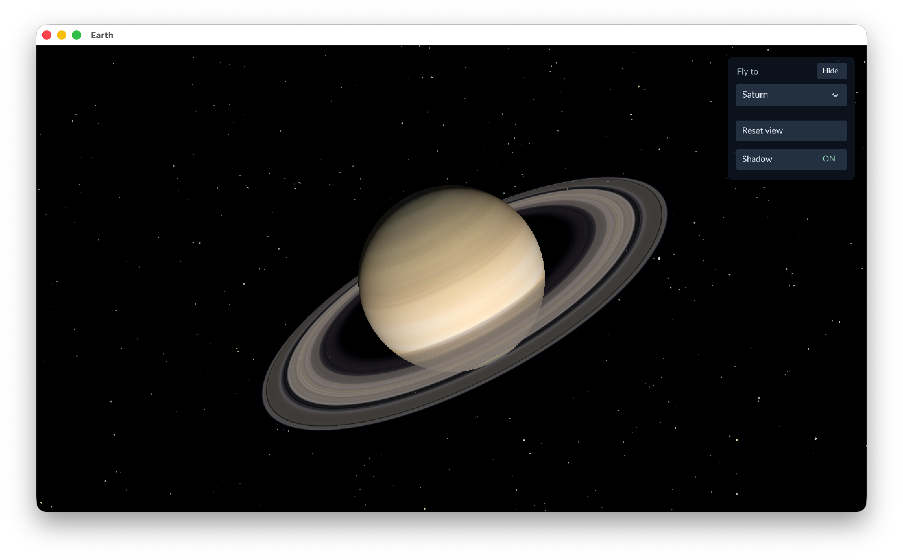
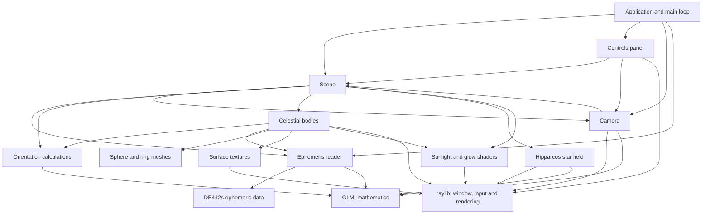

# Solar System

A solar system viewer written in C++.

<p>
  
  
  
</p>

## Setup

You need CMake 3.24 or newer, a C++23 compiler, libcurl 7.85 or newer, Git and
an internet connection for the first build.

```sh
cmake -S . -B build -DCMAKE_BUILD_TYPE=Release
cmake --build build
./build/solar_system
```

## Data and downloads

CMake downloads [GLM 1.0.2](https://github.com/g-truc/glm) and
[raylib 6.2](https://github.com/raysan5/raylib) during configuration. The first
build downloads any missing data into `assets/`, verifies its checksum and
reuses it on later builds:

- [DE442s ephemeris](https://naif.jpl.nasa.gov/pub/naif/generic_kernels/spk/planets/de442s.bsp)
  from NASA JPL, for body positions. See [assets/README.md](assets/README.md).
- [Hipparcos star catalogue](https://heasarc.gsfc.nasa.gov/W3Browse/star-catalog/hipparcos.html)
  (ESA, 1997), from a [catalogue mirror](https://github.com/Lokilife/hipparcos-data).
- Planet, Moon and Saturn ring textures from [Solar System Scope / INOVE](https://www.solarsystemscope.com/textures/),
  licensed under [CC BY 4.0](https://creativecommons.org/licenses/by/4.0/).
- NASA's [Black Marble 2016](https://assets.science.nasa.gov/content/dam/science/esd/eo/images/imagerecords/144000/144898/BlackMarble_2016_01deg.jpg)
  composite for Earth's night lights.

The live cloud map comes from [Live Cloud Maps](https://clouds.matteason.co.uk/images/2048x1024/clouds.jpg).
Contains modified EUMETSAT data.

Pluto uses a bundled AI-assisted illustration derived from the NASA/JHUAPL/SwRI
[New Horizons global colour map](https://science.nasa.gov/resource/pluto-global-color-map/).
It fills areas without image coverage and alters some observed detail.

## Accuracy

The outer planets use DE442s system barycentres as approximations to their
centres. Their axial tilts and rotation rates use IAU models, but their starting
surface longitudes are illustrative. Stars use their Hipparcos catalogue
directions at epoch 1991.25, without proper motion or parallax.

## Licence

The original project code and material may be used and shared for non-commercial
purposes. Commercial use requires permission. See [LICENSE](LICENSE). Third-party
dependencies and assets have their own licences and notices.

## Architecture


